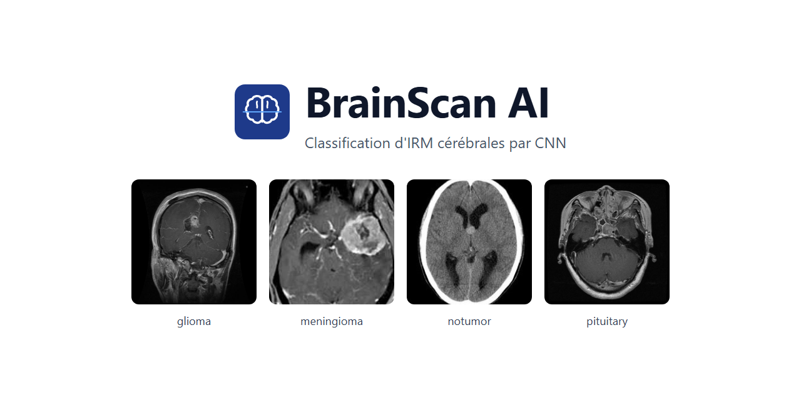
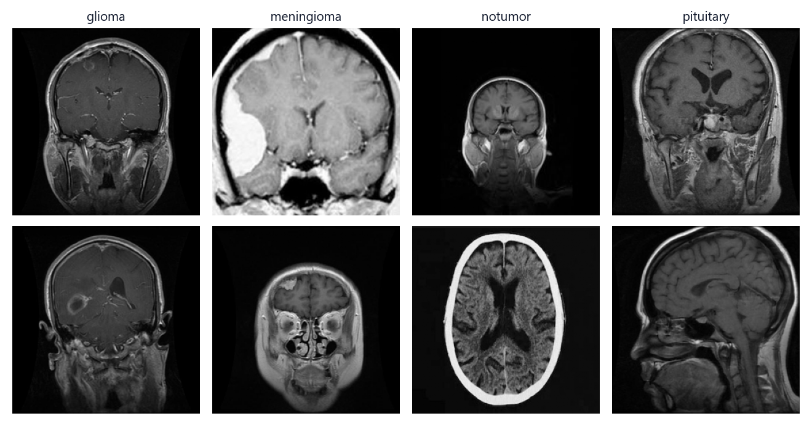
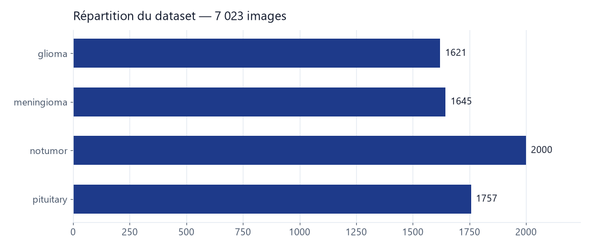
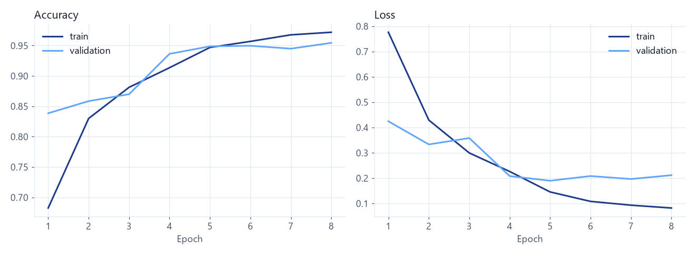
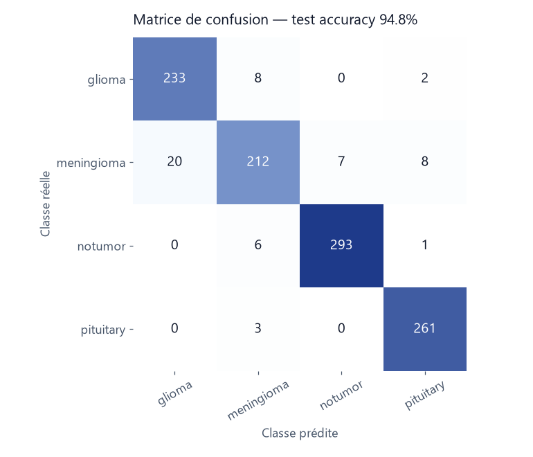

<p align="center">
  
</p>

# BrainScan AI

Classification d'images IRM cérébrales avec un réseau de neurones convolutif (CNN).
Le modèle reconnaît quatre classes :

| Classe | Description |
|---|---|
| `glioma` | Gliome, tumeur des cellules gliales |
| `meningioma` | Méningiome, tumeur des méninges |
| `notumor` | Aucune tumeur |
| `pituitary` | Tumeur de l'hypophyse |

> **Attention :** projet pédagogique. Il ne remplace pas l'avis d'un médecin et ne
> constitue pas un outil de diagnostic certifié.

<p align="center">
  
</p>

## Données

7 023 images réparties en quatre dossiers. Les extensions acceptées sont `jpg`, `jpeg`,
`png` et `bmp` ; les images illisibles sont ignorées.

<p align="center">
  
</p>

- Redimensionnement en `224x224` et normalisation entre 0 et 1.
- Séparation stratifiée : 70 % entraînement, 15 % validation, 15 % test.
- Chargement par lots de 16 images avec `tf.data` (compatible GPU 4 Go).

## Modèle

```text
Input (224, 224, 3)
Conv2D 32  -> MaxPooling
Conv2D 64  -> MaxPooling
Conv2D 128 -> MaxPooling
Flatten
Dense 128 -> Dropout 0.5
Dense 4 (softmax)
```

Optimiseur Adam, 15 epochs maximum avec `EarlyStopping` (patience 3) et sauvegarde du
meilleur modèle selon `val_accuracy`.

## Résultats

Accuracy de **94.8 %** sur le jeu de test (1 054 images).

| Classe | Précision | Rappel |
|---|:---:|:---:|
| glioma | 92.1 % | 95.9 % |
| meningioma | 92.6 % | 85.8 % |
| notumor | 97.7 % | 97.7 % |
| pituitary | 96.0 % | 98.9 % |

<p align="center">
  
</p>

<p align="center">
  
</p>

La classe `meningioma` est la plus difficile, souvent confondue avec `glioma`.

## Installation

```bash
git clone https://github.com/doughmi-ilyas/BrainScan.git
cd BrainScan
python -m venv .venv
.\.venv\Scripts\Activate.ps1
pip install -r requirements.txt
```

Placer le dataset dans `Data/`, avec un sous-dossier par classe.

## Utilisation

```bash
# Vérifier le dataset
python src/step1/inspect_folders.py
python src/step1/visualize_dataset.py

# Entraîner le modèle
python -m src.step2.train_model

# Prédire une image
python src/predict.py

# Lancer l'interface
streamlit run app.py
```

L'entraînement crée le dossier `models/` avec `brain_scan.keras`, `training_curves.png`,
`confusion_matrix.png` et `history.json`.

<details>
<summary><b>Utiliser le GPU sous Windows (WSL2)</b></summary>

<br>

TensorFlow récent n'utilise pas CUDA sous Windows natif. Il faut passer par WSL2 avec
Ubuntu et un pilote NVIDIA compatible :

```bash
wsl -d Ubuntu -- nvidia-smi
python3.13 -m venv ~/brainscan-venv
~/brainscan-venv/bin/pip install "tensorflow[and-cuda]"
~/brainscan-venv/bin/pip install opencv-python scikit-learn matplotlib pillow
```

Lancer ensuite l'entraînement depuis la racine du projet avec ce Python.

</details>

## Structure

```text
BrainScan/
├── assets/                       # Images du README
├── Data/                         # Dataset (non versionné)
├── models/                       # Modèle entraîné (non versionné)
├── notebooks/01_traitement.ipynb # Explication étape par étape
├── src/step1/                    # Inspection, préparation, visualisation
├── src/step2/                    # Architecture et entraînement du CNN
├── src/predict.py                # Prédiction sur une image
├── app.py                        # Interface Streamlit
└── requirements.txt
```

## Limites

La performance dépend de la qualité du dataset. Un usage clinique demanderait des tests
externes, une validation médicale, une analyse des biais et une certification.
